---
# Published sheet for the e2e tests, built only by `npm run build:e2e`, never in production.
title: Test sheet
tagline: Published sheet used by the end-to-end tests.
stack: [TypeScript]
repo: https://github.com/MarvinLeRouge/MarvinLeRouge.dev-Website
screenshot:
  src: ../images/example.png
  full: ../images/example.png
  alt: Placeholder screenshot of the test sheet
keywords: [Testing, Accessibility, CI]
recruiter:
  problem: Check the sheet layout on the built site.
  built: A published sheet, absent from the real site.
  result: The view switch is tested in production conditions.
lastAction: Added an architecture diagram
order: 1
draft: false
---

Lead dev view of the test sheet.

### Architecture

The Markdown sheet goes through the Astro build, which produces the static site and feeds the end-to-end tests.

### Key decisions

Section text.

### A difficulty

Section text.

### Quality

Section text.

### Timeline

Section text.

### What I would do differently

Section text.
