Engineering-Radar comes from an observation about my own portfolio: each repository had its strengths and its gaps, and I had no reliable overall view. Rather than a checklist kept by hand, I wanted a repeatable measure, backed by well-known tools, and able to track progress over time.

### Architecture

The system is split into four packages. `radar-core` holds the data model, with its migrations. `radar-audit` is a CLI: it detects each repository's sub-projects and their stack, runs the matching tools with crash isolation, then normalizes their raw output into findings and scores, criterion by criterion. `radar-api` serves the reports, findings, score history and roadmap, with protected write routes for human verdicts. `radar-dashboard`, in Vue 3, shows the report, the roadmap and the trends of each repository.

### Key decisions

- **Methodology before code.** The quality framework (categories, criteria, weights, critical penalties) was frozen and versioned before the first line of code, then calibrated on two pilot repositories with different stacks. A score has to stay comparable over time: a change of method never silently rewrites history.
- **Pinned tools, installed by the radar.** Tool versions are the radar's, not the audited repository's. Otherwise, a plain dependency update in the repository would move its score.
- **Three states per criterion, never a silent zero.** A criterion is scored, not applicable with a reason, or not audited yet. A tool that crashes is missing data, not a flawless repository.
- **The human stays in charge.** Judgment-based criteria go through a confirmation before they count. Every finding can get a verdict, false positive or won't fix, with a note explaining it; that verdict is kept from one audit to the next.

### A difficulty

The first pilot audit, run by hand on GeoChallenge-Tracker, reported six secrets found by Gitleaks in the git history. In the framework, a confirmed secret is a critical penalty: the Security category is capped, however good the rest is.

All six results were false positives: fake tokens, in test files, on variables named `fake_token`. The tool was right on the form, the string did look like an API key, but wrong on the substance. Applied as is, the rule would have sunk the score of a project with no real secret at all.

I drew two mechanisms from it. First a pre-filter: a result in a test folder, on a `fake_`, `mock_` or `dummy_` variable, or in an example configuration file, is kept at low confidence instead of being counted as confirmed. Then the human verdict, already planned in the design, which handles the remaining cases. It then had to be made durable: at first, a new audit recreated the findings and lost the verdicts. Each finding now carries a stable fingerprint, which carries the verdict over from one audit to the next. The lesson: a deterministic tool gives a reproducible result, not necessarily a real problem.

### Quality

The Python packages are tested with pytest and the dashboard with Vitest. The GitHub Actions CI runs each suite on every change and enforces a minimum coverage threshold for each package. Ruff, mypy, ESLint and Prettier run before each commit and in CI. Engineering-Radar audits itself, several times a week: its own findings feed its roadmap. Decisions are recorded in ADRs.

### Timeline

- **Late August 2026:** architecture, tool selection and evaluation, quality framework frozen then calibrated on two pilot repositories; then data model and audit engine.
- **September 2026:** architecture, code quality, testing, security, maintainability, DevOps, documentation and observability categories; API and dashboard.
- **October 2026:** finding prioritization, score calibration, global score and history per repository, CI, verdicts kept across audits.
- **November 2026:** regular self-audit, explanatory notes on verdicts, git-ignored files excluded from every analysis, documentation refresh.
- **Coming next:** quality badge for READMEs (in progress), Performance category, categories 10 to 15, portfolio-wide analysis.

### What I would do differently

I would set up CI from day one. It arrived almost two months after the first commit, while CI presence and health are among the criteria the tool checks in other projects. As long as it was missing, the tests only ran on my machine, and the project did not meet its own definition of quality.
