GeoChallenge-Tracker comes from a personal practice: I am a geocacher, and I wanted the tool to do the counting for me. It is also the most complete project of the portfolio, from GPX file parsing to the interactive map, through authentication security.

### Architecture

The FastAPI backend follows a hexagonal layout: routes, domain, services, technical core and data access are kept apart. The import reads the GPX or ZIP exports of geocaching apps, stores caches and finds in MongoDB, then spots the challenge caches among them. Each challenge carries its rules as an expression tree, compiled into a MongoDB query to measure progress and look for target caches. The Vue 3 frontend shows the matrices, calendars and maps; map tiles go through an nginx proxy with a disk cache.

### Key decisions

- **Rules as data, not code.** Rather than a hand-written checker for each kind of challenge, a rule is an expression tree: conditions (type, size, difficulty, terrain, country, placement date, attributes) combined with logical operators, plus aggregates (sums, number of distinct countries, complete matrix). The tree is validated, normalized, then compiled into a MongoDB query. A new challenge is described, not programmed.
- **Let the database do the geometry.** Radius and bounding box searches rely on a spherical geospatial index in MongoDB, rather than on filtering in Python afterwards. The database only returns the caches in the area, even across thousands of points.
- **A tile proxy rather than direct calls to OpenStreetMap.** Tiles are served by an nginx that spreads requests across several OSM servers and keeps a copy on disk. The project stays within OSM's usage policy, and a tile already seen no longer goes back over the network.
- **Sync in the same request as the import.** At first, the frontend triggered the challenge update with a second call, after the import. A tab closed between the two, and the challenges stayed wrong without any signal. The backend now chains it itself and returns its result with the import's.

### A difficulty

The map of finds by department required placing each cache in a zone. I planned three passes: is the point inside a polygon; if not, what does Nominatim's reverse geocoding say; if not, which polygon is the nearest, within about ten kilometers. That last pass was there for a good reason: outlines are simplified, and a cache by the sea can fall just outside its department.

Then I found caches in Llívia, a Spanish enclave inside French territory, a few kilometers from the border. This case brought out two problems. The first is the accuracy of a border's outline, departmental or national: near a boundary, a simplified outline can put a point on the wrong side. The second is nesting: a polygon can contain another one that belongs to a different entity. In the data, the Pyrénées-Orientales polygon does have a hole where the enclave is; but a point in that hole found no department, and the third pass attached it to the nearest one.

The fix relies on the country rather than on distance. Reverse geocoding now returns the country code: a point identified as foreign is excluded from the proximity fallback, and caches are filtered by country before assignment even starts. The lesson stayed with me: a fallback that is sound in the general case turns wrong as soon as real geography steps outside the model.

### Quality

The backend is tested with pytest, the frontend with Vitest, and both suites run on every change in a GitHub Actions CI, with coverage tracked separately per part on Codecov; the README badges give the current figures. The CI also audits dependencies (pip-audit, npm audit). A full security audit, run against the OWASP Top 10 and ASVS, led to targeted fixes: rate limiting on authentication, refresh token revocation, password hashing moved to Argon2id with transparent migration of existing accounts, a cap on the decompressed size of imported archives. Decisions are recorded in ADRs.

### Timeline

- **September 2025:** application foundations (FastAPI API, MongoDB, Vue 3 frontend), first frontend tests, map tile caching.
- **Fall 2025:** user challenges, database backup and restore, multi-format GPX import, matrix and calendar.
- **Spring 2026:** moved behind Traefik, set up to serve all my applications as subdomains, email sending, map of finds by administrative zone.
- **Summer 2026:** full security audit and fixes, interface audit (dark mode, accessibility).
- **Since:** test coverage campaign, CI harmonization, container hardening.

### What I would do differently

I would set up tests and CI from the start. For months, features piled up with partial coverage, and it took a dedicated campaign to catch up, route by route. The catch-up mostly cost confidence: every refactoring of that period was done without a full safety net. Written along the way, those tests would have cost less, and would have guided the design rather than recording it after the fact.
