HexaRot starts from an alphabet I came across in geocaching, Hexahue, which encodes each letter in colours. What interested me was not the alphabet itself, but a question: what do you gain by adding a well-chosen layer to a simple cipher that already exists?

### Architecture

The NestJS backend splits encryption into modules: visual alphabet, grid construction, rotation engine, key codec, reading orders, PNG and SVG renderers, parameter validation. The text is uppercased and its accents transliterated; a character outside the alphabet is reported to the user rather than silently dropped. The grid is cut into square blocks, each turned according to a sequence picked among 24 permutations, in one direction and following one of four reading orders. The key packs all these parameters into a short base36 string. The Vue 3 frontend offers encryption, decryption and key generation; PostgreSQL, through Prisma, stores the alphabet definition and the user accounts.

### Key decisions

- **Turn the cells, not the symbols.** Rotating whole letters would leave each symbol readable, only moved. Rotations work on square blocks of coloured cells, which cut symbols into pieces and mix fragments of neighbouring letters.
- **Detect weak parameters with the GCD.** A Hexahue symbol is two cells by three. If the block size shares a divisor with either dimension, rotations partly fall back on symbol boundaries and the cryptogram keeps some structure. The validator detects it with a GCD computation and warns the user, who can override it knowingly.
- **A key has no business in a URL.** Parsing a key first went through a URL parameter. But a URL ends up in server logs, proxy logs and browser history. The key now travels in the request body.
- **Measure rather than assume.** The correlation score compares the grid before and after rotation, cell by cell, with Cohen's kappa: 0 means no more resemblance than chance, 1 means identical grids. It is the starting point to evaluate what the rotation layer really brings.

### A difficulty

To know where the message ends in the randomly completed grid, I first built a header storing its length, meant to be drawn above the cryptogram. I dropped it before writing the renderers: it gave an attacker information about the plaintext they would not otherwise have, the opposite of what a cipher is for.

That left decryption: without a length, where to stop? The first option was to cut at the first unrecognized symbol, since random padding mostly forms blocks that match no letter. Mostly, but not always: padding can form a real letter by chance, and the cut would then land in the wrong place, with no way for anyone to notice.

I chose to decode everything, without guessing. The message comes out intact, followed by the padding, mostly shown as question marks. It is not the neatest result on screen, but it is the most honest: no heuristic truncates real content or appends noise without saying so. The decision and its limits are recorded in an ADR.

### Quality

The backend is tested with Jest, with unit tests and end-to-end API tests, the frontend with Vitest, and everything runs on every change in a GitHub Actions CI, with coverage tracked separately per part on Codecov; the README badges give the current figures. TypeScript runs in strict mode on both sides. A design and usability review led to a series of fixes: the key removed from URLs and downloaded file names, stale results flagged rather than deleted, contrast and keyboard navigation. Production deploys only go out after a successful CI run. Decisions are recorded in ADRs.

### Timeline

- **March 2026:** project foundations and CI, then the core of the cipher in a few days: key codec, GCD validation, grid construction, rotation engine.
- **August 2026:** PNG and SVG renderers, API, interface, then a design and usability review and its fixes.
- **September 2026:** user accounts and administration, automated production deployment, correlation score, CI and documentation harmonization.
- **Coming next:** French interface, animated decryption mode, spiral reading order.

### What I would do differently

I would run a security risk assessment before each roadmap step. The length header was built before I weighed what it revealed, and the key went through a URL until a review caught it. One question asked at each step, "what does this format, algorithm or route leak?", would have brought these points up before writing the code, rather than after.
