JobFlow was born out of a very concrete annoyance: every morning, a pile of job alerts, half of them announcing the same offer in three different outfits. I ended up writing the pipeline I wish I had found.

### Architecture

The pipeline chains four independent stages: fetching the emails through the Gmail API, renaming and indexing them, extracting the offers, then syncing to Google Sheets. Each stage is a standalone script, with its own dry-run mode. They share a single state: a JSON ledger keyed by each email's Message-ID, which knows what has already been processed. An orchestrator chains them and stops at the first error, so a stage never works on a state left inconsistent by the previous one. Before anything is written to the sheet, a gate stops the pipeline run if the previous sync failed.

### Key decisions

- **A ledger rather than a rescan.** Instead of re-reading every email on each run, each stage checks the ledger and only processes what is left. Re-running a stage after a partial failure avoids redoing the work already done.
- **One parser per provider, not a generic scraper.** These emails are marketing messages, not an API, and each provider has its own layout quirks. Seven small functions, each tested with its own samples, turned out simpler than an abstraction that would have special-cased every exception anyway.
- **Cross-provider deduplication, deliberately fuzzy.** The Message-ID prevents processing the same email twice, but not the same offer relayed by two providers. A second key, built from the company, the city and a normalized title, matches offers even when their texts are not identical character for character.
- **Block rather than retry.** After a failed sync, the pipeline refuses to restart until the error has been acknowledged by hand. A bit of friction, in exchange for the guarantee of never trusting a sheet that is no longer current.

### A difficulty

The gate did exactly its job: a sync failed, the pipeline stopped, and once the error was acknowledged, everything started again. Except that the next sync only read the import file of the day. The offers of the failed day were never imported again: 69 rows were missing from the sheet, without a single error message.

So the flaw was not in the gate, but in the assumption it protected: "each day imports its own offers". I wrote a recovery script that compares the sheet with the full history of imports, finds the gaps and fills them, while staying idempotent like the rest of the pipeline. The lesson stuck: a gate protects against the error you planned for, not against the one you did not imagine.

### Quality

The project is covered by a pytest suite, run on every change by a GitHub Actions CI, with coverage tracked on Codecov; the README badges give the current figures. The split of the parser, originally a single file of about 1100 lines, was done test first: characterization tests written against the old code served as a safety net throughout the move. The architecture choices are recorded in ADRs, and an operations guide describes the known incidents and how to resolve them.

### Timeline

- **June 2026:** first local scripts, with emails downloaded and imported into the sheet by hand.
- **August 2026:** tooling (tests, lint, hooks), JSON ledger, automatic fetch through the Gmail API, sync to Google Sheets, error gate, and the split of the parser.
- **September 2026:** recovery script after the missing rows incident, ADRs, documentation, then CI and coverage tracking.
- **Since then:** ongoing maintenance, with new filters, provider formats that change, and a new provider.

### What I would do differently

I would plan the filtering of irrelevant listings from the start. Providers often slip into their alerts offers that have nothing to do with the original search, for commercial reasons of their own. I discovered it through use and added the filters afterwards (blacklist, internships and work-study, offers outside my stack or my profile), each with its own backfill script to reclassify the rows already imported. Planned from the start, this sorting would have been a stage of the pipeline in its own right, rather than a series of fixes.
