Summit-Stats started from a hiker's question: am I really getting better on steep climbs, or only on the flat? Sports apps answer with averages over the whole outing, which blend terrains together. I wanted figures slope by slope.

### Architecture

The Laravel backend analyzes each track through a chain of single-responsibility services, coordinated by an orchestrator: GPX reading, optional altitude enrichment through OpenTopoData, distance and elevation computations, cutting into typed segments, metric aggregation. Import progress is streamed live to the browser. The Vue 3 frontend shows the dashboard, the zoomable elevation profile with Chart.js and the OpenStreetMap map with Leaflet, synchronized on hover. Map tiles go through a proxy with a cache capped in size and duration.

### Key decisions

- **A pipeline of composable services, written in strict TDD.** Each analysis step is an isolated service with its own unit tests, written before the code. A wrong metric traces back to a single service, and a regression test on a real GPX track guards the whole chain.
- **Smooth the altitude before counting elevation gain.** GPS altitude jitters by a few meters from one point to the next, and summing those raw deltas inflates the elevation gain. A five-point moving average, then a half-meter noise threshold, give a credible figure. The trade-off is accepted: on my most demanding outings, the smoothing also flattened a few real passages steeper than 40%, as if they were GPS errors.
- **Three tiers of tests, and a deploy gated on the last one.** Pest tests the backend, Vitest the Vue components, and Playwright the complete flows in a real browser, on the real Docker stack. Production deploys only go out if those end-to-end tests pass.
- **SQLite for tests, PostgreSQL in production.** Tests run on an in-memory database, so they are fast; the code goes through Eloquent, with no engine-specific SQL, to stay portable. That choice is also what hid the bug told below.

### A difficulty

The first two releases were tested in depth, but only with unit and feature tests, on in-memory SQLite. The first time the end-to-end tests ran on the full Docker stack, uploading a GPX track failed. No error message, no failing test anywhere else: everything passed, except in the real environment.

It took about twenty diagnostic commits to find the cause: storage directories created at startup, PHP-FPM process permissions, the upload API tested on its own before Playwright, PHP environment diagnostics in the CI. The culprit was the storage library's stream-based file write, which failed without any signal under PHP-FPM in the container. Writing the file in one go, from its content, fixed it.

This bug only existed in the real stack, out of reach of tests that ran from the command line on an in-memory database. That is exactly what the third tier of tests is meant to catch, and it is what made me gate every deploy on their success.

### Quality

The backend is tested with Pest, the frontend with Vitest, and the complete flows with Playwright, each in its own GitHub Actions CI job. Coverage is tracked separately per part on Codecov, with a minimum threshold enforced on the backend; the README badges give the current figures. PHPStan, Pint and ESLint run before each commit and in CI. An audit against the OWASP Top 10 and ASVS led to hardening the API: login attempt limiting, token expiry, restricted CORS, security headers, GPX parsing protected against XML attacks, bounded inputs. Decisions are recorded in ADRs.

### Timeline

- **2025:** early work, outside the repository.
- **March 2026:** V1 shipped in two days, in strict TDD (GPX pipeline, REST API, dashboard, CI), then V2 (elevation profile, map, tracks without timestamps, altitude enrichment).
- **Late March and early April 2026:** V3, with the Docker stack, PostgreSQL, end-to-end tests and production deployment behind Traefik, gated on those tests.
- **June to September 2026:** password login, security audit and hardening, static analysis, database backups, documentation and ADRs, CI harmonization.

### What I would do differently

I would set up Docker and end-to-end tests from the start. Two whole releases were validated on an in-memory database, without the real server, and the first run on the real stack revealed a bug the entire test suite had let through. A production-like stack from V1 would have shown it the same day, instead of costing a day of diagnostics.
