Triton is a personal project: I wanted to combine military concepts with ideas that come from my hobbies. For this first stage, it is the sonar search for a fugitive. The core of the subject is search theory: deciding where to look when you never really know where the target is.

### Architecture

The project is split into three layers that are tested separately. The engine, in Python with NumPy, depends on no interface and no transport: it advances the simulation turn by turn, each entity moves and listens once, the probability maps are updated, then the outcome is evaluated. The FastAPI API streams each turn's state over WebSocket. The Vue 3 frontend draws the grid, the drones, the sonar cones and the probability heatmap on a Canvas. Docker Compose and Traefik have been there since the first phase, with the same routing in development and production.

### Key decisions

- **Probabilistic rather than binary detection.** A drone listens in a cone aligned with its heading, and the probability of detection decays exponentially with distance. It also depends on the target's noise, easier to hear when it moves, and on the drone's attention, which rises when it chains contacts. A single parameter tunes the decay, without touching the geometry.
- **Reason on a belief map, not on a last known position.** Each grid cell holds a probability of presence, revised by a Bayesian update after each sweep, whether there was a detection or not. Between sweeps, a diffusion spreads probability to neighboring cells to account for the target's movement. Such a map can hold several hypotheses at once, for example when the target may have gone in two directions.
- **Several search strategies rather than one.** Strategies share a common interface: one heads for the most likely cell in reach, the other methodically covers the areas above the mean. They are reassigned at random, drone by drone, during a game, so the fleet does not behave like one drone repeated. Adding a new one only takes implementing the interface, which makes it a testing ground to compare approaches.
- **One map per drone, fused regularly.** At first, the whole fleet shared a single map. When drone autonomy became a goal, that choice got in the way: each drone now keeps its own map, fed by its own sweeps only, and the maps are fused every ten turns into a consensus sent back to the fleet.

### A difficulty

When a drone confirms a contact, the others drop their search to join it. To keep the whole fleet from lining up on one axis, I had set a minimum spacing between drones, derived from the sonar range: eight cells. The logic was consistent in itself, and the tests passed.

The final review, backed by figures, showed something else: 83% of regroup turns left drones standing still. Drones spawn six cells or less apart, so already under the minimum spacing; since any position too close was rejected, a drone already too close could not move at all. The fix only rejects moves that reduce the gap further. I also measured a variant, which computed cell occupancy from the lead drone's position before its move: it stacked two drones on the same cell in about 26% of regroup turns, and I discarded it.

The lesson is recorded in the ADR: a parameter derived from another engine constant must be checked against the real configuration values, not only against its own consistency.

### Quality

The engine and the API are tested with pytest, the frontend with Vitest, and both suites run on every change in a GitHub Actions CI, with coverage tracked separately per part on Codecov; the README badges give the current figures. Python code is checked by ruff and mypy, the frontend by ESLint, oxlint and the TypeScript compiler. The engine's randomness (detections, strategy switches) goes through an injectable generator, which makes every behavior reproducible in tests. Design decisions are recorded in ADRs, and the documentation is bilingual.

### Timeline

- **June 2026:** scoping, project foundations (grid, entities, full chain from the engine to the display, Docker and Traefik), then the sonar detection model.
- **August 2026:** Bayesian probability map and heatmap, search strategies and detection state machine, target behavior, fleet coordination.
- **September and October 2026:** CI harmonization, bilingual documentation and ADRs.
- **Coming next:** scenario configuration, replayability, security audit, design work and an online demo.

### What I would do differently

I would plan the security audit and the demo in more detail from the start. The phases were designed around the engine, and the demo ended up at the bottom of the list. Planned from day one, it could have gone online early and grown phase after phase, with a security audit run at the same pace rather than in one block at the end.
