---
# Published sheet for the e2e tests, built only by `npm run build:e2e`, never in production.
title: Fiche de test
tagline: Fiche publiée utilisée par les tests de bout en bout.
stack: [TypeScript]
repo: https://github.com/MarvinLeRouge/MarvinLeRouge.dev-Website
screenshot:
  src: ../images/example.png
  full: ../images/example.png
  alt: Capture factice de la fiche de test
keywords: [Tests, Accessibilité, CI]
recruiter:
  problem: Vérifier le gabarit de fiche sur le site construit.
  built: Une fiche publiée, absente du site réel.
  result: Le sélecteur de vue est testé dans les conditions de la production.
lastAction: Ajout d'un schéma d'architecture
order: 1
draft: false
---

Vue lead dev de la fiche de test.

### Architecture

La fiche Markdown passe par le build Astro, qui produit le site statique et sert aux tests de bout en bout.

### Décisions clés

Texte de la section.

### Une difficulté

Texte de la section.

### Qualité

Texte de la section.

### Chronologie

Texte de la section.

### Ce que je referais autrement

Texte de la section.
