Engineering-Radar part d'un constat sur mon propre portfolio : chaque dépôt avait ses points forts et ses oublis, et je n'avais aucune vue d'ensemble fiable. Plutôt qu'une liste de contrôle tenue à la main, j'ai voulu une mesure répétable, appuyée sur des outils reconnus, et capable de suivre une progression dans le temps.

### Architecture

Le système est découpé en quatre paquets. `radar-core` porte le modèle de données, avec ses migrations. `radar-audit` est une CLI : elle détecte les sous-projets de chaque dépôt et leur stack, lance les outils adaptés en isolant les plantages, puis normalise leur sortie brute en constats et en notes, critère par critère. `radar-api` expose les rapports, les constats, l'historique des notes et la roadmap, avec des routes d'écriture protégées pour les verdicts humains. `radar-dashboard`, en Vue 3, affiche le rapport, la roadmap et les tendances de chaque dépôt.

### Décisions clés

- **La méthodologie avant le code.** Le référentiel de qualité (catégories, critères, pondérations, pénalités critiques) a été figé et versionné avant la première ligne de code, puis calibré sur deux dépôts pilotes aux stacks différentes. Une note doit rester comparable dans le temps : un changement de méthode ne réécrit jamais l'historique en silence.
- **Des outils figés, installés par le radar.** Les versions des outils sont celles du radar, pas celles du dépôt audité. Sinon, une simple mise à jour de dépendance dans le dépôt ferait bouger sa note.
- **Trois états par critère, jamais un zéro silencieux.** Un critère est noté, non applicable avec une raison, ou pas encore audité. Un outil qui plante est une donnée manquante, pas un dépôt sans défaut.
- **L'humain garde la main.** Les critères qui relèvent du jugement passent par une confirmation avant de compter. Chaque constat peut recevoir un verdict, faux positif ou à ne pas corriger, avec une note qui l'explique ; ce verdict est conservé d'un audit à l'autre.

### Une difficulté

Le premier audit pilote, lancé à la main sur GeoChallenge-Tracker, a remonté six secrets détectés par Gitleaks dans l'historique git. Or, dans le référentiel, un secret confirmé est une pénalité critique : la catégorie Sécurité est plafonnée, quelle que soit la qualité du reste.

Les six résultats étaient des faux positifs : de faux jetons, dans des fichiers de test, sur des variables nommées `fake_token`. L'outil avait raison sur la forme, la chaîne ressemblait à une clé d'API, mais tort sur le fond. Appliquée telle quelle, la règle aurait fait chuter la note d'un projet sans aucun secret réel.

J'en ai tiré deux mécanismes. D'abord un pré-filtre : un résultat situé dans un dossier de test, sur une variable `fake_`, `mock_` ou `dummy_`, ou dans un fichier d'exemple de configuration, est retenu avec une confiance faible au lieu d'être compté comme confirmé. Ensuite le verdict humain, déjà prévu dans la conception, qui traite les cas restants. Il a fallu ensuite le rendre durable : au départ, un nouvel audit recréait les constats et perdait les verdicts. Chaque constat porte désormais une empreinte stable, qui permet de reporter le verdict d'un audit à l'autre. La leçon : un outil déterministe donne un résultat reproductible, pas forcément un vrai problème.

### Qualité

Les paquets Python sont testés avec pytest et le tableau de bord avec Vitest. La CI GitHub Actions lance chaque suite à chaque modification et impose un seuil de couverture minimal pour chaque paquet. Ruff, mypy, ESLint et Prettier tournent avant chaque commit et en CI. Engineering-Radar s'audite lui-même, plusieurs fois par semaine : ses propres constats alimentent sa roadmap. Les décisions sont consignées dans des ADR.

### Chronologie

- **Fin août 2026 :** architecture, choix et évaluation des outils, référentiel de qualité figé puis calibré sur deux dépôts pilotes ; puis modèle de données et moteur d'audit.
- **Septembre 2026 :** catégories architecture, qualité du code, tests, sécurité, maintenabilité, DevOps, documentation et observabilité ; API et tableau de bord.
- **Octobre 2026 :** priorisation des constats, calibrage des notes, score global et historique par dépôt, CI, verdicts conservés entre deux audits.
- **Novembre 2026 :** auto-audit régulier, notes explicatives sur les verdicts, fichiers ignorés par git exclus de toutes les analyses, documentation mise à jour.
- **À venir :** badge de qualité pour les README (en cours), catégorie Performance, catégories 10 à 15, analyse à l'échelle du portfolio.

### Ce que je referais autrement

Je mettrais la CI en place dès le premier jour. Elle est arrivée près de deux mois après le premier commit, alors que la présence et la santé de la CI font partie des critères que l'outil vérifie chez les autres. Tant qu'elle manquait, les tests ne tournaient que sur ma machine, et le projet ne respectait pas sa propre définition de la qualité.
