HexaRot part d'un alphabet croisé en géocaching, Hexahue, qui code chaque lettre en couleurs. Ce qui m'intéressait n'était pas l'alphabet lui-même, mais une question : que gagne-t-on en ajoutant une couche bien choisie à un système de chiffrement simple qui existe déjà ?

### Architecture

Le backend NestJS découpe le chiffrement en modules : alphabet visuel, construction de la grille, moteur de rotation, codec de clé, ordres de lecture, rendus PNG et SVG, validation des paramètres. Le texte est mis en majuscules et ses accents translittérés ; un caractère hors alphabet est signalé à l'utilisateur plutôt que supprimé en silence. La grille est découpée en blocs carrés, chacun tourné selon une séquence choisie parmi 24 permutations, dans un sens et selon l'un des quatre ordres de lecture. La clé regroupe tous ces paramètres en une courte chaîne base36. Le frontend Vue 3 propose le chiffrement, le déchiffrement et la génération de clés ; PostgreSQL, via Prisma, stocke la définition de l'alphabet et les comptes utilisateurs.

### Décisions clés

- **Faire tourner les cases, pas les symboles.** Faire pivoter des lettres entières laisserait chaque symbole lisible, seulement déplacé. Les rotations portent sur des blocs carrés de cases colorées, qui coupent les symboles en morceaux et mélangent les fragments de lettres voisines.
- **Détecter les paramètres faibles par le PGCD.** Un symbole Hexahue fait deux cases sur trois. Si la taille des blocs partage un diviseur avec l'une de ces dimensions, les rotations retombent en partie sur les frontières des symboles et le cryptogramme garde de la structure. Le validateur le détecte par un calcul de PGCD et prévient l'utilisateur, qui peut passer outre en connaissance de cause.
- **La clé n'a rien à faire dans une URL.** L'analyse d'une clé passait d'abord par un paramètre d'URL. Or une URL finit dans les journaux du serveur, ceux du proxy et l'historique du navigateur. La clé passe désormais dans le corps de la requête.
- **Mesurer plutôt que supposer.** Le score de corrélation compare la grille avant et après rotation, case par case, avec le kappa de Cohen : 0 signifie qu'il ne reste pas plus de ressemblance que le hasard, 1 que les grilles sont identiques. C'est le point de départ pour évaluer ce que la couche de rotations apporte vraiment.

### Une difficulté

Pour savoir où s'arrête le message dans la grille complétée au hasard, j'avais d'abord construit un en-tête qui stockait sa longueur, destiné à être dessiné au-dessus du cryptogramme. Je l'ai abandonné avant d'écrire les rendus : il donnait à un attaquant une information sur le texte en clair qu'il n'avait pas autrement, à l'opposé du but du chiffrement.

Restait le déchiffrement : sans longueur, où s'arrêter ? La première option était de couper au premier symbole non reconnu, puisque le remplissage aléatoire forme le plus souvent des blocs qui ne correspondent à aucune lettre. Le plus souvent, mais pas toujours : un remplissage peut former une vraie lettre par hasard, et la coupure tomberait alors au mauvais endroit, sans que personne puisse s'en apercevoir.

J'ai choisi de tout décoder, sans deviner. Le message ressort intact, suivi du remplissage, affiché le plus souvent sous forme de points d'interrogation. Ce n'est pas le résultat le plus propre à l'écran, mais c'est le plus honnête : aucune heuristique ne tronque un vrai contenu ou n'ajoute de bruit sans le signaler. La décision et ses limites sont consignées dans un ADR.

### Qualité

Le backend est testé avec Jest, en tests unitaires et en tests de bout en bout de l'API, le frontend avec Vitest, et tout tourne à chaque modification dans une CI GitHub Actions, avec un suivi de couverture séparé par partie sur Codecov ; les badges du README donnent les chiffres à jour. Le TypeScript est en mode strict des deux côtés. Une revue de conception et d'ergonomie a donné lieu à une série de corrections : la clé retirée des URL et des noms de fichiers téléchargés, les résultats périmés signalés plutôt que supprimés, le contraste et la navigation au clavier. Le déploiement en production ne part qu'après une CI réussie. Les décisions sont consignées dans des ADR.

### Chronologie

- **2025 :** premiers travaux, hors dépôt.
- **Mars 2026 :** socle du projet et CI, puis le cœur du chiffrement en quelques jours : codec de clé, validation par PGCD, construction de la grille, moteur de rotation.
- **Août 2026 :** rendus PNG et SVG, API, interface, puis revue de conception et d'ergonomie et ses corrections.
- **Septembre 2026 :** comptes utilisateurs et administration, déploiement automatisé en production, score de corrélation, harmonisation de la CI et de la documentation.
- **À venir :** interface en français, mode de déchiffrement animé, ordre de lecture en spirale.

### Ce que je referais autrement

Je ferais une évaluation des risques de sécurité avant chaque étape de la roadmap. L'en-tête de longueur a été construit avant que je mesure ce qu'il révélait, et la clé est passée par une URL jusqu'à ce qu'une revue le relève. Une question posée à chaque étape, "qu'est-ce que ce format, cet algorithme ou cette route laisse fuir ?", aurait fait émerger ces points avant d'écrire le code, plutôt qu'après.
