JobFlow est né d'un agacement très concret : chaque matin, une pile d'alertes emploi, dont la moitié annonçait la même offre sous trois habillages différents. J'ai fini par écrire le pipeline que j'aurais aimé trouver.

### Architecture

Le pipeline enchaîne cinq étapes indépendantes : la récupération des emails par l'API Gmail, leur renommage et leur indexation, l'extraction des offres, la synchronisation vers Google Sheets, puis le rangement dans Gmail (emails marqués comme lus, classés sous un libellé et archivés). Chaque étape est un script autonome, avec son mode de simulation. Elles partagent un seul état : un registre JSON indexé par le Message-ID de chaque email, qui sait ce qui a déjà été traité. Un orchestrateur les enchaîne et s'arrête à la première erreur, pour qu'une étape ne travaille jamais sur un état laissé incohérent par la précédente. Avant l'écriture dans le tableau, un garde-fou arrête l'exécution du pipeline si la synchronisation précédente a échoué.

### Décisions clés

- **Un registre plutôt qu'un rescan.** Plutôt que de relire tous les emails à chaque passage, chaque étape consulte le registre et ne traite que ce qui reste à faire. Relancer une étape après un échec partiel évite donc de refaire le travail déjà fait.
- **Un module d'extraction par fournisseur, pas un extracteur générique.** Ces emails sont des messages marketing, pas une API, et chaque fournisseur a ses bizarreries de mise en page. Sept petites fonctions, chacune testée avec ses propres exemples, se sont révélées plus simples qu'une abstraction qui aurait dû traiter chaque exception à part.
- **Une déduplication entre fournisseurs, volontairement floue.** Le Message-ID évite de traiter deux fois le même email, mais pas la même offre relayée par deux fournisseurs. Une seconde clé, construite à partir de l'entreprise, de la ville et d'un titre normalisé, rapproche les offres même quand leurs textes ne sont pas identiques au caractère près.
- **Bloquer plutôt que réessayer.** Après un échec de synchronisation, le pipeline refuse de repartir tant que l'erreur n'a pas été acquittée à la main. Un peu de friction, en échange de la garantie de ne jamais croire à jour un tableau qui ne l'est plus.

### Une difficulté

Le garde-fou a fait exactement son travail : une synchronisation a échoué, le pipeline s'est arrêté, et une fois l'erreur acquittée, tout est reparti. Sauf que la synchronisation suivante ne lisait que le fichier d'import du jour. Les offres du jour de l'échec n'ont jamais été réimportées : 69 lignes manquaient dans le tableau, sans le moindre message d'erreur.

La faille n'était donc pas dans le garde-fou, mais dans l'hypothèse qu'il protégeait : "chaque jour importe ses propres offres". J'ai écrit un script de récupération qui compare le tableau à l'historique complet des imports, détecte les trous et les comble, en restant idempotent comme le reste du pipeline. La leçon m'est restée : un garde-fou protège contre l'erreur qu'on a prévue, pas contre celle qu'on n'a pas imaginée.

### Qualité

Le projet est couvert par une suite de tests pytest, exécutée à chaque modification par une CI GitHub Actions, avec un suivi de couverture sur Codecov ; les badges du README donnent les chiffres à jour. Le découpage de l'extracteur, à l'origine un seul fichier d'environ 1100 lignes, a été fait test d'abord : des tests de caractérisation écrits sur l'ancien code ont servi de filet de sécurité pendant tout le déménagement. Les choix d'architecture sont consignés dans des ADR, et un guide d'exploitation décrit les incidents connus et leur résolution.

### Chronologie

- **Juin 2026 :** premiers scripts locaux, avec téléchargement manuel des emails et import manuel dans le tableau.
- **Août 2026 :** outillage (tests, lint, hooks), registre JSON, récupération automatique par l'API Gmail, synchronisation vers Google Sheets, garde-fou d'erreur, et découpage de l'extracteur.
- **Septembre 2026 :** script de récupération après l'incident des lignes manquantes, ADR, documentation, puis CI et suivi de couverture.
- **Depuis :** maintenance au fil de l'eau, avec de nouveaux filtres, des formats de fournisseurs qui changent, et un nouveau fournisseur.

### Ce que je referais autrement

J'anticiperais le filtrage des annonces sans rapport avec la recherche. Les fournisseurs glissent souvent dans leurs alertes des offres qui n'ont rien à voir avec la recherche de départ, pour des raisons commerciales qui leur sont propres. Je l'ai découvert à l'usage et j'ai ajouté les filtres après coup (liste noire, stages et alternances, offres hors de ma stack ou de mon profil), chacun avec son script de rattrapage pour reclasser les lignes déjà importées. Prévu dès le départ, ce tri aurait été une étape à part entière du pipeline, plutôt qu'une série de correctifs.
