Summit-Stats part d'une question de randonneur : est-ce que je progresse vraiment en montée raide, ou seulement sur le plat ? Les applications de sport répondent par des moyennes sur toute la sortie, qui mélangent les terrains. J'ai voulu des chiffres pente par pente.

### Architecture

Le backend Laravel analyse chaque trace par une suite de services à responsabilité unique, coordonnés par un orchestrateur : lecture du GPX, enrichissement optionnel de l'altitude par OpenTopoData, calculs de distance et de dénivelé, découpage en segments typés, agrégation des métriques. L'avancement de l'import remonte en direct au navigateur. Le frontend Vue 3 affiche le tableau de bord, le profil altimétrique zoomable avec Chart.js et la carte OpenStreetMap avec Leaflet, synchronisés au survol. Les tuiles de carte passent par un proxy avec un cache limité en taille et en durée.

### Décisions clés

- **Un pipeline en services composables, écrit en TDD strict.** Chaque étape de l'analyse est un service isolé, avec ses propres tests unitaires, écrits avant le code. Une métrique fausse se rattache à un seul service, et un test de régression sur une vraie trace GPX protège l'ensemble.
- **Lisser l'altitude avant de compter le dénivelé.** L'altitude GPS oscille de quelques mètres d'un point à l'autre, et additionner ces écarts bruts gonfle le dénivelé positif. Une moyenne glissante sur cinq points, puis un seuil de bruit d'un demi-mètre, donnent un dénivelé crédible. La contrepartie est assumée : sur mes sorties les plus engagées, le lissage a aussi aplati quelques passages réels à plus de 40 %, comme s'il s'agissait d'erreurs GPS.
- **Trois niveaux de tests, et un déploiement conditionné au dernier.** Pest teste le backend, Vitest les composants Vue, et Playwright les parcours complets dans un vrai navigateur, sur la vraie stack Docker. La mise en production ne part que si ces tests de bout en bout passent.
- **SQLite pour les tests, PostgreSQL en production.** Les tests tournent sur une base en mémoire, donc vite ; le code passe par Eloquent, sans SQL propre à un moteur, pour rester portable. C'est aussi ce choix qui a caché le bug raconté plus bas.

### Une difficulté

Les deux premières versions étaient testées en profondeur, mais uniquement en tests unitaires et fonctionnels, sur SQLite en mémoire. Au premier lancement des tests de bout en bout sur la stack Docker complète, l'import d'une trace GPX échouait. Aucun message d'erreur, aucun test rouge ailleurs : tout passait, sauf dans le vrai environnement.

Il a fallu une vingtaine de commits de diagnostic pour en trouver la cause : dossiers de stockage créés au démarrage, droits du processus PHP-FPM, test de l'API d'import isolé avant Playwright, diagnostics de l'environnement PHP dans la CI. La cause était l'écriture du fichier par flux de la bibliothèque de stockage, qui échouait sans rien signaler sous PHP-FPM dans le conteneur. L'écrire en une seule fois, à partir de son contenu, a réglé le problème.

Ce bug n'existait que dans la stack réelle, hors de portée des tests qui tournaient en ligne de commande sur une base en mémoire. C'est exactement ce que le troisième niveau de tests est censé attraper, et c'est ce qui m'a décidé à conditionner chaque déploiement à leur réussite.

### Qualité

Le backend est testé avec Pest, le frontend avec Vitest, et les parcours complets avec Playwright, chacun dans son propre job de CI GitHub Actions. La couverture est suivie séparément par partie sur Codecov, avec un seuil minimal imposé côté backend ; les badges du README donnent les chiffres à jour. PHPStan, Pint et ESLint tournent avant chaque commit et en CI. Un audit sur la grille OWASP Top 10 et ASVS a conduit au durcissement de l'API : limitation des tentatives de connexion, expiration des jetons, CORS restreint, en-têtes de sécurité, lecture des fichiers GPX protégée contre les attaques XML, entrées bornées. Les décisions sont consignées dans des ADR.

### Chronologie

- **Mars 2026 :** V1 livrée en deux jours, en TDD strict (pipeline GPX, API REST, tableau de bord, CI), puis V2 (profil altimétrique, carte, traces sans horodatage, enrichissement de l'altitude).
- **Fin mars et début avril 2026 :** V3, avec la stack Docker, PostgreSQL, les tests de bout en bout et la mise en production derrière Traefik, conditionnée à ces tests.
- **De juin à septembre 2026 :** connexion par mot de passe, audit de sécurité et durcissement, analyse statique, sauvegardes de la base, documentation et ADR, harmonisation de la CI.

### Ce que je referais autrement

Je mettrais Docker et les tests de bout en bout en place dès le départ. Deux versions entières ont été validées sur une base en mémoire, sans le serveur réel, et le premier passage sur la vraie stack a révélé un bug que toute la suite de tests avait laissé passer. Une stack proche de la production dès la V1 l'aurait montré le jour même, au lieu de coûter une journée de diagnostic.
